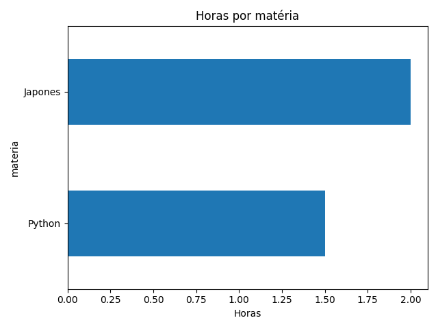
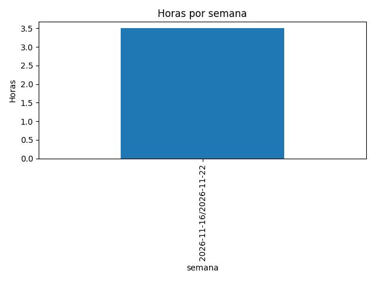

# Análise de Horas de Estudo

## Problema
Quero entender como distribuo meu tempo de estudo entre as matérias.

## Ferramentas
Python, pandas e matplotlib, no Google Colab.

## Como rodar
1. Abra o notebook `analise_horas_estudo.ipynb` no Google Colab
2. Faça upload do arquivo `estudo.csv`
3. Execute as células

## Resultados

### Horas por matéria

### Horas por semana

## Conclusões
- Japonês é a matéria com mais horas registradas (2h), seguida de Python (1,5h).

## Próximos passos
- Continuar registrando por 3 a 4 semanas
- Comparar teoria e prática
